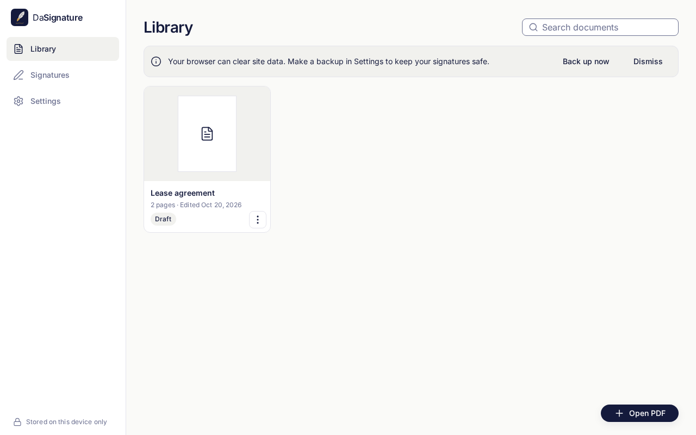
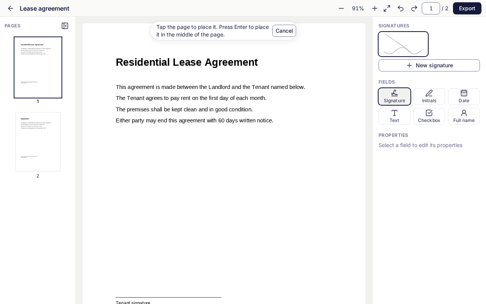
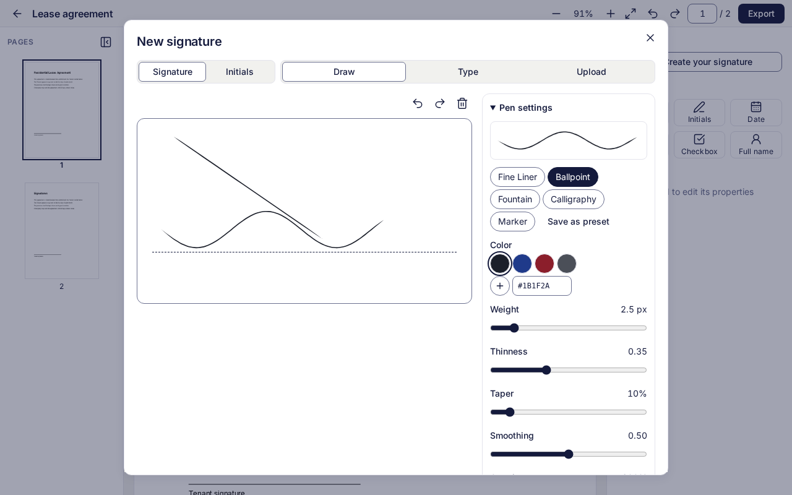
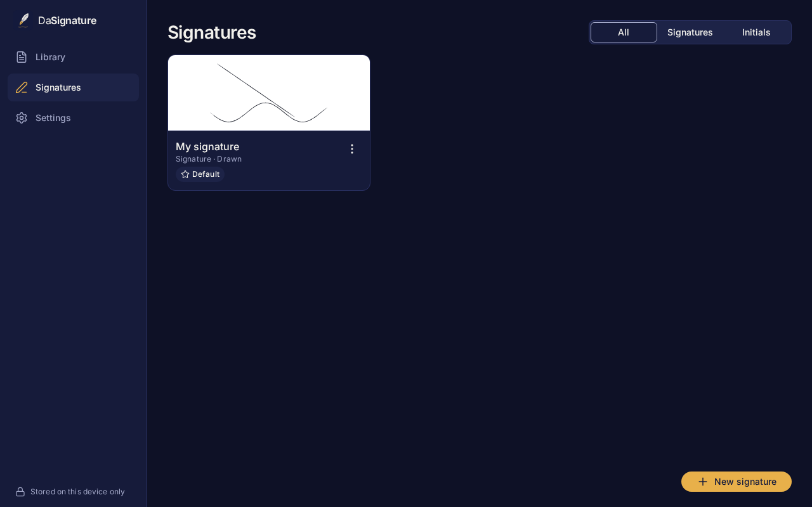
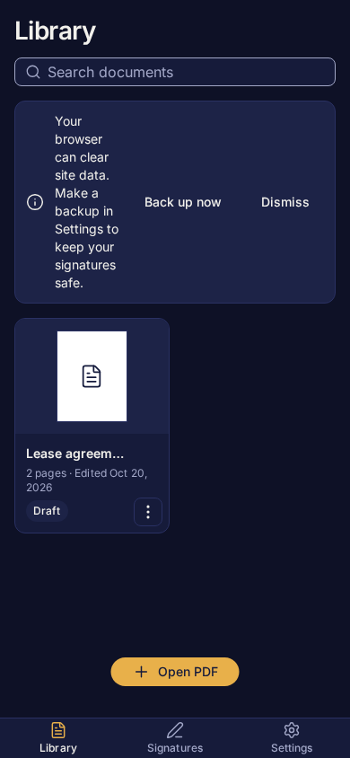

# DaSignature

A private, local-first, open-source PDF signing app for the web (PWA), Windows, macOS, Linux,
Android and iOS, built from one TypeScript codebase. **Your files never leave your device.** There
are no accounts, no servers, no analytics, and the app makes no network calls at runtime.
The public guide pages on the website (`/guides`) are separate from the app; see
[docs/seo.md](docs/seo.md).



- Open a PDF (file picker, drag and drop, "Open with", the share sheet, or a PWA file handler),
  including password-protected PDFs.
- Draw, type, upload or scan a signature. Place signatures, initials, dates, text, checkboxes and
  your full name. Then move, resize and rotate them, with undo/redo and autosave.
- Export a flattened signed copy with an optional audit page and an embedded audit trail (signer,
  time, SHA-256 of the original). Check later whether a file is an exact copy you exported.
- Everything is encrypted at rest (AES-256-GCM per value, plus SQLCipher on desktop and Android),
  with an optional passcode lock and encrypted `.dasig` backups.
- Light and dark themes, English and Arabic (RTL), keyboard and screen-reader accessible.

|                                         |                                                  |
| --------------------------------------- | ------------------------------------------------ |
|   |  |
|  |              |

## Run on PC

### Windows

1. Run `DaSignature_<version>_x64-setup.exe`. It installs for the current user only, so no
   administrator rights are needed. If WebView2 is missing it is installed from the bootstrapper
   included in the setup file; that is the only network access, and it happens during setup.
2. **SmartScreen:** the installer isn't code-signed yet, so Windows may show "Windows protected
   your PC". Click **More info**, then **Run anyway**. You can check the file first:
   `certutil -hashfile DaSignature_<version>_x64-setup.exe SHA256` must match `SHA256SUMS.txt`
   in the release.
3. Start DaSignature from the Start menu. PDFs get an "Open with DaSignature" entry.

### Linux

- Debian/Ubuntu: `sudo apt install ./DaSignature_<version>_amd64.deb`
- Fedora/openSUSE: `sudo dnf install ./DaSignature-<version>-1.x86_64.rpm`
- Any distro: `chmod +x DaSignature_<version>_amd64.AppImage && ./DaSignature_<version>_amd64.AppImage`.
  The AppImage uses the system WebKitGTK 4.1 (`libwebkit2gtk-4.1-0` / `webkit2gtk4.1`), which
  current GNOME/KDE desktops already have.
- The database key is kept in the desktop keyring (GNOME Keyring or KWallet through the Secret
  Service). A desktop session normally provides one.

### macOS

macOS builds aren't in this release (they need a Mac to build and notarize). Build from source:
`pnpm install && pnpm --filter @dasignature/desktop tauri build --bundles dmg`.

### Web app without installing anything

Unzip the `web` folder from the release and run `run.bat` (Windows) or `./run.sh`
(macOS/Linux). It starts a small local server with Node.js 18+ (`server.mjs`, no
dependencies, listens on this computer only) and opens http://127.0.0.1:4173, or the next free
port. Nothing is fetched from the internet. You can also host `web/dist` on any static host. See [docs/deploy-render.md](docs/deploy-render.md) for Render.

## Android and iOS

Android: install `DaSignature-<version>-arm64-v8a.apk` (most phones) or the universal APK, and
allow "Install unknown apps" for your file manager. The app asks for no permissions, not even
Internet. iOS ships as source only: `pnpm --filter @dasignature/mobile sync:ios`, then open
`apps/mobile/ios/App/App.xcworkspace` in Xcode.

## Develop

Requires Node 20.19+ and pnpm 10 (plus `python3` for the token lint).

```sh
pnpm install
pnpm dev         # web app at http://localhost:5173
pnpm lint        # ESLint + Prettier + design-token checks
pnpm typecheck   # strict TypeScript in every package
pnpm test        # Vitest in every package
pnpm build       # production web build (apps/web/dist)
pnpm test:e2e    # Playwright on the production build (run `pnpm build` first)
pnpm size        # web initial-JS budget (< 250 KiB gzip)
pnpm check:licenses && pnpm check:audit && pnpm check:render && pnpm check:notices
```

- Desktop (Tauri 2): Rust plus the platform WebView dependencies, then
  `pnpm --filter @dasignature/desktop tauri build`. Windows can be cross-built from Linux with
  `scripts/release/windows.sh` (cargo-xwin, NSIS). The lean AppImage comes from
  `scripts/release/appimage-lean.sh`.
- Android: JDK 21 and the Android SDK, then `pnpm --filter @dasignature/mobile sync:android` and
  `./gradlew assembleRelease` in `apps/mobile/android` (add `keystore.properties` to sign).

## Layout

```
apps/web          Vite + React PWA (the shared frontend for every platform)
apps/desktop      Tauri 2 shell (src-tauri: storage, keyring, file association, menu)
apps/mobile       Capacitor shell (Android plugin: SQLCipher, Keystore, intents)
packages/core     services, types, pen engine
packages/pdf      pdf.js rendering and export (pdf-lib)
packages/storage  storage adapters, migrations, encryption, backups
packages/ui       design tokens, theming, icons
packages/i18n     locales and RTL
docs/             SPEC, decisions, privacy, formats, deploy guide
assets/logo       brand assets
```

## Documentation

[Privacy](docs/privacy.md) · [Security policy](SECURITY.md) · [Contributing](CONTRIBUTING.md) ·
[Design decisions](docs/decisions.md) · [Backup format](docs/backup-format.md) ·
[Deploy on Render](docs/deploy-render.md) · [Third-party notices](THIRD_PARTY_NOTICES.md)

DaSignature makes simple electronic signatures (an image of your signature on the page). It
doesn't create certificate-based digital signatures (PAdES). Check which kind your document
needs.

## License

Apache-2.0. See [LICENSE](LICENSE). Bundled components are listed in
[THIRD_PARTY_NOTICES.md](THIRD_PARTY_NOTICES.md).
